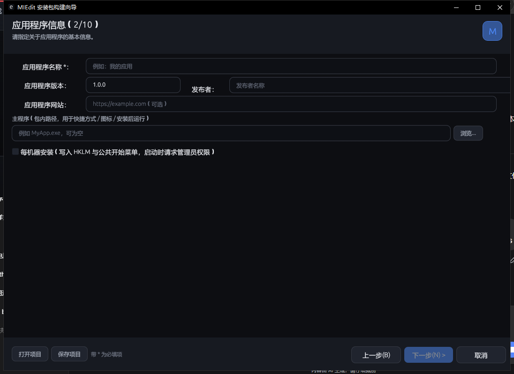
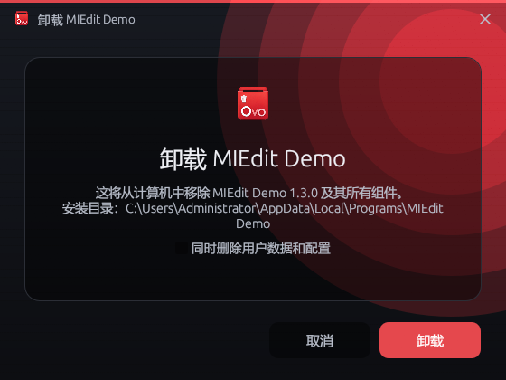

# MIEdit — Ming-Install-Edit

**纯 Rust 实现的 Windows 安装包制作工具**——类 NSIS / Inno Setup 的现代替代品。

从一份 TOML 脚本（或 10 步 GUI 向导）+ 一组文件，编译出**自解压安装包 EXE**：现代化无边框
安装向导（支持**全窗口图片背景**）、**组件选择**（NSIS Section / Inno Components）、
**安装后任务**（Inno [Run]）、**NSIS 式自包含卸载器**（清单内嵌 EXE，自删除含目录清理）、
磁盘空间检测、运行中检测、UAC 提权、静默模式、键盘操作（Enter/Esc）等。

<p align="center">
  
  
</p>
<p align="center">
  
</p>

> 设计经验取自 NSIS 与 Inno Setup 的**真实源码**（clone 至本地研究），
> 取长补短的分析见 [docs/lessons-from-nsis-inno.md](docs/lessons-from-nsis-inno.md)。

## 特性一览

| 能力 | 说明 |
| --- | --- |
| **GUI 构建向导** | HM NIS Edit / Inno Setup 式 **10 步向导**：欢迎 → 应用信息 → 安装程序选项（**实时预览**）→ 目录与授权 → 文件与组件 → 快捷方式 → 完成后运行 → 卸载与注册表 → **项目脚本**（查看/编辑/应用 `.miedit.toml`）→ 构建（wpReady 式摘要 + 一键构建） |
| 脚本驱动 | 一份 `.miedit.toml` 描述应用、文件、组件、UI 与快捷方式，与向导完全互通 |
| 自解压安装器 | 单文件 EXE：`[stub][payload][config][卸载器][背景图][图标][Trailer]` |
| 现代化 UI | egui 无边框窗口、玻璃卡片、主题色可配、自绘进度条、中文字体自适应 |
| **全窗口图片背景** | `background = "bg.png"`，`cover / contain / stretch` 三种模式 |
| 安装向导 | 欢迎 → 许可（可强制滚动到底）→ 组件选择（**Space required 联动**）→ 目录（**磁盘空间检测**）→ 安装进度（计数/速度/**细节开关**）→ 完成（**多任务复选**） |
| **组件选择** | NSIS Section / Inno Components 风格：`[[components]]` + 规则引用，必装锁定、全选/重置 |
| **安装类型** | NSIS `InstallTypes` / Inno `[Types]` 对齐：`[[install_types]]` 组件页顶部单选（Typical/Full/…），切换类型联动组件勾选；手动改动任意组件自动切到 **Custom** |
| **组件描述侧栏** | NSIS 组件页描述框对齐：悬停/点击组件行，下方描述面板跟随显示 `description`，必装组件带「必需」徽标，空描述显示占位 |
| **安装后任务** | Inno [Run] 风格：`[[install.run_tasks]]` 完成页复选，支持 exe 参数与文档打开 |
| **NSIS 式卸载器** | **自包含**：清单与图标内嵌 `uninstall.exe`（MRISUNIN 尾部，无外部 json）；确认页（可勾选删除用户数据）→ 进度（细节默认收起可展开）→ 完成 |
| **自删除** | 自身移入 %TEMP% + 分离 cmd：等待退出 → 删除自身 → `rd /s /q` 清理安装目录 → 重试 |
| 卸载注册表 | HKLM/HKCU `...\Uninstall\{app_id}`（控制面板可见），支持自定义注册表键值 |
| 快捷方式 | 开始菜单（自动含“卸载”快捷方式）与桌面，per-machine / per-user 自适应 |
| **默认图标** | 未配置图标时自动使用内置 **modern-install.ico / modern-uninstall.ico**（NSIS 做法），PE 资源 + 窗口图标同步替换 |
| **EXE 版本信息** | 安装器/卸载器 EXE 嵌入 VERSIONINFO（NSIS `VIProductVersion` / `VIAddVersionKey` 对齐）：产品名/版本/公司/描述/版权，资源管理器属性可见 |
| 磁盘空间检测与目录校验 | 目录页可用空间**随所选驱动器实时刷新**（NSIS DirectoryPage），无效路径/不存在盘符拒绝前进；`allow_root_dir_install` 根目录安装开关（NSIS `AllowRootDirInstall` 默认禁根目录） |
| **步骤导航** | HM NIS Edit 向导式**左列步骤导航栏**：当前步高亮/已完成勾点，`ui.show_step_rail` 可关 |
| **界面模板** | 五套内置模板一键切换：`ui.template = aurora / midnight / sunrise / forest / mono` |
| **液态玻璃** | `ui.material = "glass"` 半透明卡片 + 高光描边（默认）；`ui.acrylic` 启用 Win11 亚克力背景板（失败自动回退） |
| **Linux 适配** | 安装器/卸载器 Linux 可用：XDG 路径模板、`.desktop` 快捷方式、`uninstall.json` 清单卸载、CJK 字体回退；CI 产出 Linux zip |
| **命令行安装** | `--silent` `--dir=` `--components=` `--no-shortcuts` `--repair` `--help` `--version`，退出码 0/1/2（NSIS `/S` + Inno `/COMPONENTS` 语义） |
| 运行中检测 | 安装前独占探测主程序占用，重试/继续 |
| 升级检测 | 发现旧版本记录版本号并静默卸载后升级（`InstallDirRegKey` 式目录记忆） |
| 权限 | `per_machine = true` 启动时自动 UAC 提权重启 |
| 静默模式 | 安装器/卸载器均支持 `--silent`（NSIS `/S` 风格）与 `--dir=`，可自动化测试 |
| **覆盖策略** | NSIS `SetOverwrite` 对齐：`on / off / try / ifnewer`；安装后保留源文件时间戳，`ifnewer` 仅在源更新时覆盖 |
| **快捷方式增强** | Inno `[Icons]` 对齐：`[[shortcuts.entries]]` 自定义名称/子目录/参数/图标/工作目录/描述，位置多选（开始菜单/桌面/快速启动栏），与简单开关叠加兼容 |
| **最小系统版本门槛** | Inno `MinVersion` 对齐：`install.min_version`，RtlGetVersion 取真实版本（不受兼容性垫片影响），低于门槛启动即拒 |
| **多语言向导** | NSIS MUI2 `MUI_LANGUAGE` 对齐：`[[ui.languages]]` 语言包（id + 显示名 + 文案覆盖），内置 zh-CN / en-US 双语包，>1 语言时欢迎页前显示语言选择页，按系统 UI 语言自动预选；`ui.text` 仍是最高优先级单键覆盖 |
| **卸载统计** | NSIS 卸载完成统计对齐：完成页展示已删除文件数/目录数/释放空间（含用户数据目录递归统计） |
| **覆盖失败重试交互** | NSIS 文件错误对话框对齐：安装中文件被占用写不进时弹出「重试 / 忽略 / 中止」模态卡片——重试循环、忽略记录日志并继续、中止说明已写入文件去向；静默模式自动忽略并计划重启替换 |
| **安装期重启替换** | NSIS `SetRebootFlag` / Inno `restartreplace` 对齐：被占用文件先改名腾位立即写入新内容，旧文件调度重启删除（`PendingFileRenameOperations`）；完成页琥珀提示“需要重启以完成安装”并列出文件 |
| **重启删除** | NSIS `Delete /REBOOTOK` 对齐：卸载时被占用的文件 `MoveFileEx` 计划重启删除，完成页/静默日志提示 |
| **卸载运行检测** | 卸载确认页检测主程序占用（可重新检测），静默模式记录警告后继续 |
| **QuietUninstallString** | 卸载注册表写入静默卸载入口（ARP 自动化 / NSIS 风格） |
| **修复模式** | Inno `ModifyPath` 对齐：卸载注册表写 `ModifyPath`，控制面板「更改/修复」按钮启动安装器 `--repair` 修复向导——跳过向导页直达确认页（含文件/快捷方式/注册表统计），确认后全量重装文件并重建快捷方式/注册表 |
| **完成详情停留页** | NSIS `MUI_PAGE_INSTFILES` 对齐：安装/卸载完成后停留在详情页（完成状态 + 全量日志），点「下一步」才进入完成页 |
| **卸载器壁纸** | `install.uninstall_background` 配置卸载向导背景图（编译期内嵌进卸载器 EXE），全窗铺满 + 半透明遮罩；缺省内置渐变 |
| **install.log** | NSIS `LogSet` 风格安装日志落盘到 `$INSTDIR\install.log`（`install.write_log` 可关） |
| **包完整性校验** | NSIS `CRCCheck` 对齐：安装包尾写入 payload/config/uninstaller 三分区 CRC32（MIEDPKG3），启动时流式校验，损坏包报"安装包已损坏"；`--ncrc` / `/ncrc` 跳过；旧格式包仍可安装 |
| 压缩 | `deflate`（条目级）或 `solid`（整包 Deflate，NSIS solid 风格，体积更小） |
| Unicode | 中文路径 / 文件名 / UI 全支持 |
| 纯 Rust | 无 C 构建链依赖（egui / flate2 / walkdir / winreg / windows-rs） |

## 快速开始

```bash
cargo build --release
# target/release/: miedit-builder.exe miedit-compiler.exe miedit-installer.exe miedit-uninstaller.exe
```

### 用 GUI 构建向导制作（推荐）

```bash
target/release/miedit-builder.exe
# 或直接打开示例项目（跳到第 2 步）
target/release/miedit-builder.exe examples/demo-app.miedit.toml
```

### 用 CLI 编译

```bash
target/release/miedit-compiler.exe build examples/demo-app.miedit.toml -o out/MIEdit-Demo-Setup.exe
```

### 安装 / 卸载

```bash
out/MIEdit-Demo-Setup.exe                        # GUI 安装
out/MIEdit-Demo-Setup.exe --silent               # 静默安装（日志 %TEMP%\miedit-install.log）
out/MIEdit-Demo-Setup.exe --silent --ncrc        # 静默安装并跳过包 CRC32 校验（NSIS /NCRC 语义）
out/MIEdit-Demo-Setup.exe --silent --dir="C:\My Apps\Demo"

"%LOCALAPPDATA%\Programs\MIEdit Demo\uninstall.exe"             # GUI 卸载（可勾选删除用户数据）
"%LOCALAPPDATA%\Programs\MIEdit Demo\uninstall.exe" --silent    # 静默卸载（保留用户数据）
```

## 脚本参考（`.miedit.toml`）

完整示例见 [`examples/demo-app.miedit.toml`](examples/demo-app.miedit.toml)。

```toml
[app]
name = "MIEdit Demo"          # 应用名（必填）
version = "1.2.0"
publisher = "MIEdit Project"
url = "https://example.com"   # 可选，写入注册表 URLInfoAbout
exe = "MyApp.exe"             # 主程序（包内相对路径）
icon = "app.ico"              # 可选；缺省使用内置 modern-install.ico
per_machine = false           # true = 每机器（HKLM + 公共开始菜单 + UAC）

[install]
dir_template = "{autopf}\\{app_name}"      # 占位符：{autopf} {autopf86} {localappdata} {appdata} {desktop} {docs} {app_name}
compression = "deflate"                    # deflate（条目级）| solid（整包 Deflate，体积更小）
overwrite = "on"                           # NSIS SetOverwrite：on（默认）| off | try | ifnewer
write_log = true                           # 安装日志写入 $INSTDIR\\install.log（NSIS LogSet 风格）
user_data_dirs = ["{appdata}\\{app_name}"] # 卸载时可勾选删除
uninstall_icon = "uninstall.ico"           # 可选；缺省使用内置 modern-uninstall.ico
min_version = "6.1"                        # 可选；最低系统版本门槛（如 6.1 = Win7，10.0 = Win10）

[[install.run_tasks]]         # Inno [Run] 风格：完成页复选框
name = "运行 {app}"
exe = "MyApp.exe"

[ui]
window_size = [960.0, 640.0]
background = "bg.png"         # ★ 全窗口图片背景
background_style = "cover"
accent = "#3B82F6"
license = "LICENSE.txt"
license_scroll_required = true
show_components_page = true
[ui.text]                     # UI 文案覆盖（键见下表），支持 {app} {version} {file} {size} {free}；优先级最高
language_auto_detect = true   # 按系统 UI 语言自动预选（默认 true）

[[ui.languages]]              # NSIS MUI2 MUI_LANGUAGE 风格语言包（可选，>1 个时显示语言选择页）
id = "zh-CN"                  # BCP 47 风格 id；与内置包匹配时缺键自动补全
name = "简体中文"             # 语言选择页显示名
[ui.languages.text]           # 该语言的文案覆盖（未覆盖键由内置 zh-CN 包补全）
next = "下一步"

[[ui.languages]]
id = "en-US"
name = "English"

[shortcuts]
start_menu = true             # 自动含“卸载”快捷方式
desktop = true

[[shortcuts.entries]]         # Inno [Icons] 风格快捷方式条目（可选，与上方开关叠加）
name = "使用指南"             # 快捷方式名称
exe = "docs/guide.md"        # 目标（包内相对路径，空 = 主程序）
subfolder = "工具"            # 开始菜单子目录（空 = 应用名分组目录）
icon = "docs/icon.ico"       # 图标（包内相对路径，空 = 目标自身）
working_dir = ""              # 工作目录（空 = 目标所在目录，支持 {install_dir}）
comment = "查看使用指南"      # 悬停提示
locations = ["desktop"]       # 位置多选：start_menu / desktop / quick_launch

[[files]]                     # 文件 / 目录 / 通配符（支持 ** 递归）
source = "payload/*"
dest = ""                     # 包内目标子目录（空 = 安装根目录）

[[components]]                # NSIS Section / Inno Components
name = "核心程序"
description = "主程序（必需）"
required = true               # 必装：勾选锁定
files = [0, 2]                # 引用 [[files]] 规则索引；未被引用的规则始终安装

[[install_types]]             # NSIS InstallTypes / Inno [Types]（可选）
name = "典型"
components = [0]              # 选中该类型时默认勾选的组件索引
default = true                # 默认选中的类型（未标记时取第一个）

[[install_types]]
name = "完整"
components = [0, 1]
# 手动改动任意组件勾选自动切到 Custom（组件页自动附加）

[[registry]]
key = "HKCU\\Software\\Vendor\\App"   # HKCU / HKLM 前缀
values = { InstallPath = "{install_dir}" }
```

## 架构

```
crates/
├── miedit-core         # 包格式（MIEARC2 归档 + MIEDPKG2 包尾 + MIEDUNIN 卸载内嵌）、配置、Windows 工具
├── miedit-compiler     # 打包库（build_package）+ CLI（含 PE 图标替换 UpdateResourceW）
├── miedit-builder      # GUI 构建向导（10 步，实时预览，脚本编辑）
├── miedit-installer    # 自解压安装器 Stub（egui 向导）
└── miedit-uninstaller  # 自包含卸载器 Stub（egui）
```

成品安装包布局：

```text
[stub 安装器 EXE][payload 归档][config JSON][卸载器 EXE][背景图][图标][Trailer 104B]
卸载器 EXE 尾部：[卸载清单 JSON][卸载图标][MIEDUNIN footer 24B]
```

## 测试

```bash
cargo test --workspace    # 87 个单元测试：归档/包尾/CRC32/通配符/路径安全/icon 解析/VERSIONINFO 结构回读/文件错误决策与提示信箱/重启替换/安装类型状态机/系统版本门槛/目录统计/组件过滤映射/slug/语言匹配与 LANGID 映射/多语言文案解析链/修复入口与修复统计/包尾 v4 与卸载数据新旧格式/安装目录解析与根路径校验/盘符切换空间刷新回归/内置模板色板/CLI 组件参数解析
```

已在 Windows 10 x64 实机验证：CLI 与 GUI 构建链路、静默安装/卸载全清理、组件过滤生效、
默认图标链路（未配置自动内嵌）、solid 压缩（592KB→103KB）、升级检测、旧格式兼容。

## License

MIT
